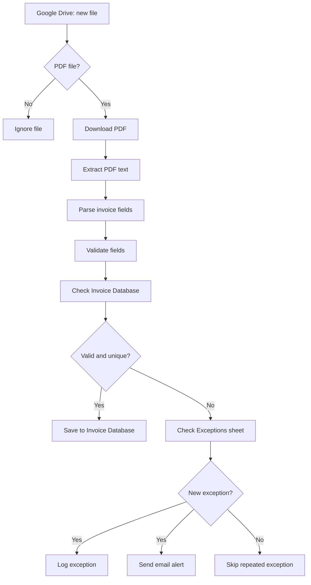

# AI-Powered Invoice Processing & Validation Automation

**Portfolio project | n8n + Google Drive + Google Sheets + Gmail**

## Project overview
This demonstration automates first-pass processing of invoice PDFs uploaded to a Google Drive folder. n8n detects new files, filters PDFs, extracts text, parses key invoice fields, validates data, checks duplicates, and routes records to either an Invoice Database sheet or an Exceptions sheet. Newly logged exceptions trigger an email notification for human review.

> Demo only: use synthetic data. This workflow is not an accounting system, payment approval system, or substitute for human review.

## Business problem
Manual invoice intake requires repetitive downloading, data entry, validation, duplicate checking, and exception follow-up. These steps can cause delays and data-entry errors.

## Solution
1. Monitor the `Project Invoice` Google Drive folder for newly created files.
2. Ignore files that are not PDFs.
3. Download each PDF and extract its text.
4. Parse invoice number, vendor, date, and total amount.
5. Validate required fields and check for duplicates.
6. Save valid, unique invoices to `Invoice Database`.
7. Log invalid or duplicate invoices in `Exceptions`.
8. Email an alert when a new exception is logged.

## Architecture

## Technology
| Tool | Purpose |
|---|---|
| n8n | Workflow orchestration and business logic |
| Google Drive | Invoice intake folder |
| Google Sheets | Invoice Database and Exceptions register |
| Gmail | Exception notification |
| PDF extraction | Extract text from text-based PDF invoices |
| JavaScript Code node | Parse and validate fields |

## Suggested sheet columns

**Invoice Database:** `invoice_no`, `vendor_name`, `invoice_date`, `total_amount`, `status`.

**Exceptions:** `invoice_no`, `vendor_name`, `invoice_date`, `total_amount`, `validation_errors`, `status`.

Keep the actual column names aligned with the Google Sheets nodes in your workflow.

## Example validation rules
- Invoice number is required.
- Vendor name is required.
- Invoice date is required and valid.
- Total amount is numeric and greater than zero.
- Same vendor + invoice number must not be saved twice.
- An already-logged exception should not create repeated rows or alerts.

Only claim rules that are actually implemented and tested in your Code and IF nodes.

## Test plan
| Test | Input | Expected outcome |
|---|---|---|
| Valid invoice | Complete, unique PDF | One row in Invoice Database |
| Missing invoice number | PDF without invoice number | Exceptions row and email alert |
| Missing amount | PDF without total amount | Exceptions row and email alert |
| Duplicate invoice | Existing vendor + invoice number | No second valid row; duplicate exception |
| Repeated exception | Same exception processed again | No repeated exception row/alert |
| Non-PDF | JPG, DOCX, or TXT | Ignored by PDF filter |
| Scanned PDF | Image-only PDF | Text extraction may fail; OCR is a future enhancement |

## Demo walkthrough (2–3 minutes)
1. Show the Drive folder and the two Sheets tabs.
2. Upload a synthetic valid invoice PDF.
3. Show the n8n execution from trigger through extraction and validation.
4. Show the new row in Invoice Database.
5. Upload an intentionally incomplete synthetic invoice.
6. Show the exception path, Exceptions row, and test email.
7. Upload a duplicate and show that it is not saved as a second valid invoice.
8. Explain the business value: less repetitive data entry, consistent first-pass validation, and faster exception visibility.

## Limitations and future improvements
- Best suited to text-based PDFs whose layout matches the parser's expected patterns.
- OCR is not included unless separately added and tested.
- Different vendor layouts may require parser improvements.
- Duplicate detection depends on the chosen key.
- Email is an alert, not an approval or payment instruction.
- Human review remains necessary for exceptions.

Future versions: OCR, AI-assisted extraction with confidence scores, human-in-the-loop approval, vendor-specific templates, purchase-order matching, audit trail, retry/error handling, and Power BI analytics.

## Security
- Use synthetic invoices in public demos.
- Hide customer names, account numbers, addresses, tax IDs, email addresses, and credentials.
- Use least-privilege Google credentials.
- Never publish credential exports or secrets in workflow JSON.
- Do not claim that the workflow approves invoices or initiates payments.

## Portfolio description
**AI-Powered Invoice Processing & Validation Automation | n8n**

Designed an n8n workflow that monitors a Google Drive folder for new invoice PDFs, extracts invoice information, validates required fields, checks for duplicates, and routes records to Google Sheets. Invalid or duplicate invoices are logged in an Exceptions register, with email alerts to support timely human review.

**Skills demonstrated:** Workflow automation, process analysis, requirements translation, data validation, exception handling, duplicate detection, Google Workspace integration, and basic JavaScript.

## Evidence to publish
- Screenshot of the complete n8n workflow.
- Successful valid-invoice execution.
- Invoice Database row with synthetic data.
- Exception execution and Exceptions sheet.
- Test email alert with synthetic data.
- Optional 2–3 minute screen recording.

Capture evidence only after hiding credentials, tokens, personal information, and real customer data.
